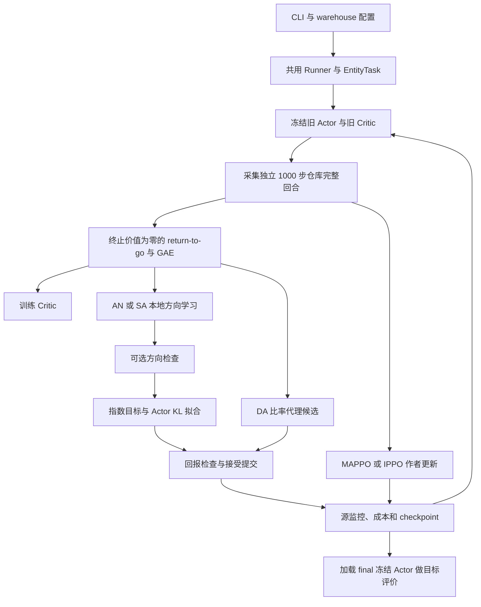

# 仓库环境：模块、观测、模型与算法数据流

本文对应 RWARE 的 W-C 源训练、W-T 冻结跨规模、W-L 请求负载对照及 W-F Actor 拟合诊断。环境实现位于本目录的 [warehouse.py](warehouse.py)，训练复用 `cooperative_navigation/` Runner，没有另一套仓库训练循环。研究设计见[总体实验方案](../../../docs/总体实验方案.md)，命令见[公共运行说明](../../README.md)。

## 1. 环境与模块组成

锁定 `rware==2.0.0`，显式固定 11×10 tiny 地图、32 个货架、2 个交付格；源 4 个机器人，目标 2、6、8 个，地图不随人数改变。默认视野半径 1、请求队列 4、任务长度 1000、gamma=0.99。

动作依次为 `noop/forward/left_turn/right_turn/toggle_load`，与导航的五动作物理含义不同。原生 GLOBAL 奖励对每人相同，适配器取其均值，将一次团队交付计一次，不能再按人数求和。交付后请求补充，任务不因第一次交付终止；第 1000 步为声明的有限任务真终止。

| 模块 | 职责 |
|---|---|
| [../../registry.py](../../registry.py)、[../../cli.py](../../cli.py) | W-C/W-T/W-L/W-F 注册、训练与评价分派 |
| [warehouse.py](warehouse.py) | 原生 RWARE 调用、字典观测、集中状态、交付及拥堵指标 |
| [__init__.py](__init__.py) | `make_env('warehouse',...)` 工厂 |
| [../../cooperative_navigation/envs/tasks.py](../../cooperative_navigation/envs/tasks.py) | `EntityTask` 将仓库字典观测接入共用采样器 |
| [../../cooperative_navigation/current_protocol.py](../../cooperative_navigation/current_protocol.py) | 仓库公共配置映射及源监控预算预留 |
| [../../cooperative_navigation/training/collector.py](../../cooperative_navigation/training/collector.py) | 独立完整回合、Actor 输入打包、真实联合步计费 |
| [../../cooperative_navigation/models/__init__.py](../../cooperative_navigation/models/__init__.py)、[../../cooperative_navigation/models/entities.py](../../cooperative_navigation/models/entities.py) | 单帧实体 Actor/方向、集中及局部 Critic |
| [../../cooperative_navigation/training/runner.py](../../cooperative_navigation/training/runner.py)、[../../cooperative_navigation/training/ppo.py](../../cooperative_navigation/training/ppo.py) | 标签、优化、候选检查、提交与保存 |
| [../../cooperative_navigation/training/author_ppo.py](../../cooperative_navigation/training/author_ppo.py)、[../../cooperative_navigation/training/entity_policy.py](../../cooperative_navigation/training/entity_policy.py) | 作者 MAPPO/IPPO 与本项目网络的适配 |
| [../evaluation.py](../evaluation.py)、[../../cooperative_navigation/models/deployment.py](../../cooperative_navigation/models/deployment.py) | 冻结策略、同地图目标人数及负载评价 |

## 2. 观测空间

设 N 为机器人数量。每名机器人读取原生自身字段和完整 3×3 本地网格，不读取全局机器人/货架名单。

| 字段 | 联合形状 | 定义 |
|---|---|---|
| `self` | `[N,9]` | 原生 x/y、是否携带货架、朝向四维 one-hot、是否在通道、剩余时间比例 |
| `entities` | `[N,9,11]` | 包含中心格的九条网格记录，顺序为 dy 后 dx 的原生行优先 |
| `mask` | `[N,9]` | 九格全有效；空格与边界 padding 也是声明观测的一部分 |

每条网格记录的 11 维顺序为：`is_grid_cell,unused_type,dx,dy,has_agent,direction_onehot_4,has_shelf,shelf_requested`。类型位固定 `[1,0]`，dx/dy 是已知本地格偏移。空格朝向仍保留原生默认值，不能用朝向 one-hot 推断一定有机器人；存在性应看 `has_agent`。

Actor 不额外读取附近机器人的载货信息、全局请求队列、实体 ID 或新增边界标记。自身剩余时间 `1-t/horizon` 是本有限任务声明输入；与导航当前无时钟协议不同。字段可能有信息压缩，不保证九格观测恢复全局状态。

### Critic 集中状态

`Warehouse.state()` 输出 $7N+3S+1$ 维，S=32：

| 部分 | 维度 | 字段 |
|---|---:|---|
| 全机器人 | 7N | 各自 x/y、朝向四维 one-hot、所携货架 ID/S（无货为 0） |
| 全货架 | 3S | 各自 x/y、是否被请求 |
| 时间 | 1 | 剩余时间比例 |

源 N=4 的集中状态为 125 维，仅供训练及源价值评价。MAPPO/方向方法/DA 的 Actor 不读取这些字段；IPPO 的 Critic 只使用上述本地观测。

### 训练内部表示

当前仓库使用单帧 `history=1`。`EntityTask.flatten` 暂时移除 `self` 的最后时间字段，将前 8 维自身字段和九条实体记录展平为 `8+9*11=107` 维；共用 `History` 加上上一动作五维 one-hot、有效位及 elapsed time，形成每人 **114 维** packed 输入。`entity_input` 恢复 9 维 self（含剩余时间）、九条 11 维实体及 mask；单帧实体网络不消费附加的上一动作位。

仓库当前没有导航的 8 帧时间融合网络；公共配置校验只允许成功式导航启用多帧历史。

| 训练字段 | 完整 E 回合批次形状 |
|---|---|
| `x` | `[E,1000,N,114]` |
| `state` | `[E,1000,7N+97]`，源末维 125 |
| `actions/mu` | `[E,1000,N]` / `[E,1000,N,5]` |
| `reward/terminated/truncated` | `[E,1000]` |
| `final_x/final_state` | `[E,N,114]` / `[E,7N+97]` |

观测/状态数组为 float32，mask 为布尔类型，动作按整数索引使用。一个联合环境步包含 N 个动作，但源步预算只计一步。

## 3. 模型结构

当前公共默认 hidden=128、heads=4、relation_layers=2，实际以 profile/覆盖解析后的配置为准。

1. 自身编码：`9 → 128 → 128`，Tanh。
2. 每条网格记录拼接自身信息：`11+9=20 → 128 → 128`，Tanh；九格共享参数。
3. 自身 token 与九格 token 组成 10 个节点，执行 2 层四头关系注意力。坐标来自已有 dx/dy，节点差构造边特征；关系层不访问真实全局地图或别人的隐藏输入。
4. 按动作查询读取两类实体。仓库仅第一类 grid-cell 有记录，第二类为空并返回零汇总；两类数量和空类标记仍送入 head。`4*128+4=516 → 128 → 1` 为每动作输出一个分数。

| 模型 | 输出/结构 |
|---|---|
| Actor | 5 个动作概率：$(1-\beta)softmax(z)+\beta/5$；公共 beta 来自 `probability_floor`，不能套用导航覆盖参数作为仓库动作含义 |
| Direction | 同构但独立参数的实体网络，$q=q_{max}(tanh(z)-mean(tanh(z)))/2$ |
| 集中 Critic | 源 `125 → 128 Tanh → 128 Tanh → 1` |
| IPPO 局部 Critic | 独立本地实体网络，动作轴分数均值作为价值 |

MAPPO-E/IPPO-E 使用 `EntityPolicy` 中同一结构的实体 Actor，并保留概率混合；作者代码负责 PPO、GAE、ValueNorm 等优化。MAPPO 与 IPPO 区别在于集中/本地价值输入，没有仓库专用递归网络。单帧仓库不经过 `TemporalEntityEncoder` 的历史分块/时间融合路径。

## 4. 算法数据流与边界

1. 每轮冻结旧策略，用相同策略收集配置规定的 `batch_episodes`。场景独立重置；到任务 horizon 真终止，不因短期无交付提前结束，也不在第一次交付时结束。
2. 冻结旧 Critic 构造 return-to-go 和默认 GAE 标签，再更新价值网络。仓库 deadline 的未来值为零，与导航外部 400 步截断的末状态自举不同。
3. AN/SA 的方向损失为解析 Fisher 二次项/采样 $f^2$ 减去 $2Af$，其中 $f=q(a)-\mathbb{E}_{\mu}q$。当前 SA 关闭检查时共享 condition 别名会改变二次项分支，详见[共用训练器实现说明](../../cooperative_navigation/模块组成说明.md)第 4 节；比较前须核对实际分支。
4. 方向检查按额外独立旧策略完整回合进行。方向通过后构造 `softmax(log(mu)+eta*q)` 并最小化前向 KL，得到可部署 Actor。
5. DA 直接优化旧策略概率比代理，当前共用 `direct` 分支保留回报检查，不训练方向。方向方法由 condition 决定是否检查回报；重试及预算保留由 Runner 控制。
6. 回报检查比较旧/候选在完整仓库任务内的实际折扣奖励，不附加导航式无限任务尾值。接受后提交 Actor；拒绝则保留旧策略。
7. MAPPO/IPPO 走作者优化路径，保留 PPO clip、优势标准化、GAE 和 ValueNorm 口径；不同方法并非只改变一项 Fisher 损失。
8. 训练、方向检查、旧/候选回报检查和源监控均计入实际源联合环境步。独立最终报告评价单列，不以交付指标或回报修改目标模型。

W-T 同地图改变人数，W-L 改变请求负载，均从已训练源 checkpoint 冻结执行，不按目标表现选源模型。W-F 依赖源训练提前启用诊断保存。人数增加同时改变拥堵和任务分工，不能仅由固定的九格输入尺寸断言输入覆盖或迁移保证。

## 5. 配置、输出与维护

配置合并为 `defaults.json → warehouse.json → profiles.json → --config → CLI/实验覆盖 → runner_config`。`warehouse.json` 固定地图及 SHA256；公共校验与适配器核对 RWARE 版本、视野、地图、请求队列。预算会被 profile 覆盖，不能单读环境 JSON 判定最终预算。方向/Actor/Critic 的 `*_steps` 在共用 Runner 中映射为 epoch。

| 修改目标 | 位置 |
|---|---|
| 原生环境参数、地图、观测、奖励、交付终止及指标 | `warehouse.py` |
| 字典展平及训练器接入 | `../../cooperative_navigation/envs/tasks.py` |
| 网络字段解码、实体结构及 Critic | `../../cooperative_navigation/models/__init__.py`、`entities.py` |
| 标签、方法优化、检查、计费及保存 | `../../cooperative_navigation/training/ppo.py`、`runner.py`、`collector.py` |
| 请求负载对照与冻结报告 | `../../cli.py`、`../evaluation.py` |

输出沿用应用训练格式：`manifest.json`、`training.csv`、`events.jsonl`、`final.pt/best.pt`、逐场景 `evaluation_episodes.csv` 和汇总。final 是主结果及恢复状态，best 是源监控选择的辅助模型；统一矩阵 CLI 未提供自动续训开关。

仓库指标包括交付总量、团队/每机器人吞吐、首次交付时间及截尾时间、最长无交付段、被阻挡前进动作。环境适配不虚构导航覆盖率或距离指标；比较时同时报告团队和每机器人吞吐，避免人数变化造成量纲误读。
