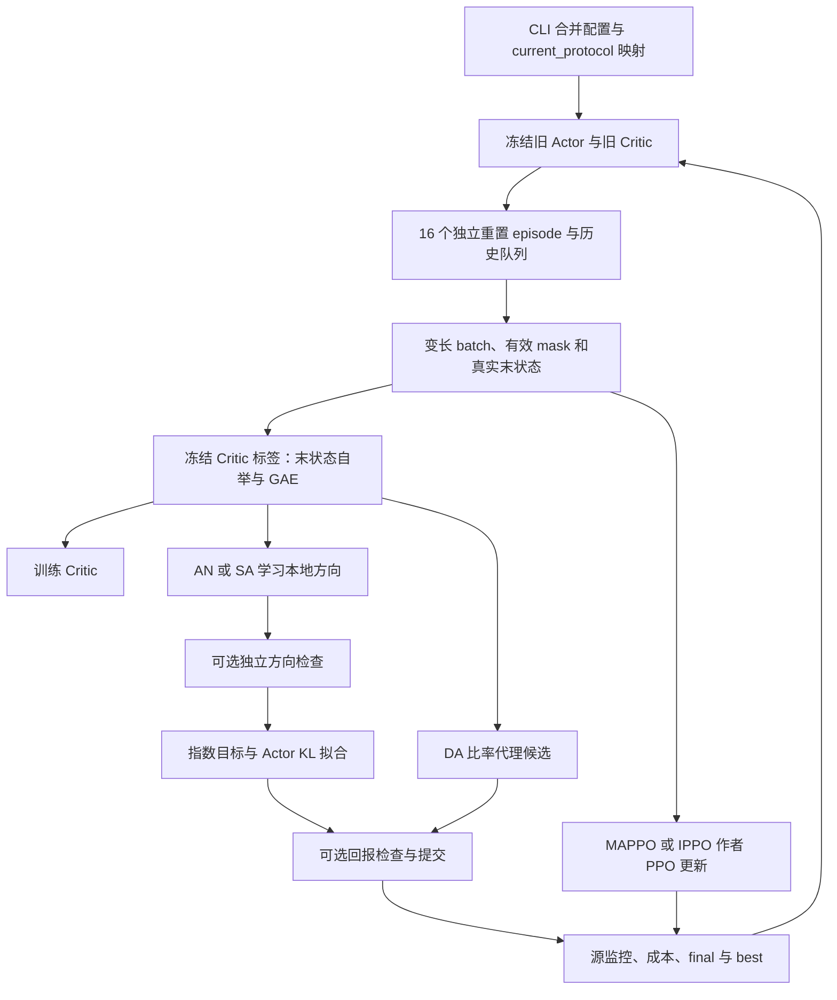

# 协作导航环境：模块、观测、模型与算法数据流

本文描述当前 `navigation-episodes-v1-history-v1` 实现。任务协议、训练命令与指标定义统一见[导航实验手册](README.md)；本文说明模块连接、观测字段、网络及张量流向，不记录运行中的性能结论。历史 streaming/单帧兼容分支不作为当前默认训练流程。

## 1. 环境与模块组成

环境为锁定 MPE2 1.1.1 的 `simple_spread`。源为 4 人/4 目标，冻结迁移为 2/2、6/6、8/8。动作索引依次为停、左、右、下、上；团队奖励取原生 agent 奖励均值，保留距离及碰撞项，`local_ratio=0.5`，不添加额外成功奖励。

成功是同一时刻每个目标到最近机器人的距离均小于 0.1，首次满足即真正终止。训练未成功则在 400 步截断并重置；评估独立观察至默认 1000 步。400 步是采样上限，不是任务价值归零的期限。

| 模块 | 职责 |
|---|---|
| [../cli.py](../cli.py)、[../registry.py](../registry.py) | N-C 源训练、N-T 冻结迁移、N-I 输入对照、N-R 关系对照、N-Gd/N-Gr 检查消融、N-F 拟合诊断、N-D 密度对照 |
| [current_protocol.py](current_protocol.py) | 公共配置转 Runner 配置，预留源监控预算，汇总训练 CSV |
| [envs/navigation.py](envs/navigation.py) | 唯一原生动力学封装、成功判断、原生观测和集中状态 |
| [../applications/envs/navigation.py](../applications/envs/navigation.py) | 同一环境的字典观测/历史接口，用于部署评价；没有第二套动力学 |
| [observations/history.py](observations/history.py) | 帧队列、上一动作、有效标记和末状态只读 `peek` |
| [training/collector.py](training/collector.py) | 独立 episode 采样、变长批次、真实末观测、采样成本 |
| [models/__init__.py](models/__init__.py)、[models/entities.py](models/entities.py) | 解码观测、实体/时间编码、Actor、方向与 Critic |
| [training/runner.py](training/runner.py)、[training/ppo.py](training/ppo.py) | 标签、各方法优化、检查、接受更新、监控及保存 |
| [training/author_ppo.py](training/author_ppo.py)、[training/entity_policy.py](training/entity_policy.py) | 作者 PPO 与本项目实体模型/采样批次的适配 |
| [models/deployment.py](models/deployment.py)、[../applications/evaluation.py](../applications/evaluation.py) | 加载冻结 Actor、独立源/目标评价 |
| [evaluation/fit_probe.py](evaluation/fit_probe.py) | 固定方向下的 Actor 拟合预算诊断；须源训练前启用 |

## 2. 观测空间与内部编码

设人数及目标数为 N、历史长度为 H。当前 N=4、H=8。下表给出环境一次联合观测的形状；每名机器人只把自己的切片送给共享 Actor。

| 字段 | 形状 | 内容 |
|---|---|---|
| `self` | `[N,4]` | 自身二维速度、二维绝对位置，顺序为速度后位置 |
| `entities` | `[N,2N-1,6]` | N 个目标与 N−1 个同伴，每条记录 6 维 |
| 实体记录 | `[6]` | `is_landmark,is_peer,relative_x,relative_y,communication_0,communication_1` |
| `mask` | `[N,2N-1]` | 字典原始全名单均有效；网络内部另屏蔽缺帧及被消融删除项 |
| 集中 `state` | `[6N]` | 全体机器人位置/速度及全体目标位置，源为 24 维 |

目标通信字段补零；同伴通信来自原生观测，当前静默机器人为零。Actor 不直接读取同伴速度、全局 state 或任务时钟。完整目标/同伴相对位置属于预先授权的本地输入，不等同于有限传感半径。

原生每人观测宽度为 $4+2N+2(N-1)+2(N-1)=6N$，源为 24。每帧另加上一动作五维 one-hot 和有效位，共 $6N+6$ 维。`History` 按从旧到新顺序展平 H 帧：

$$D_{packed}=H(6N+6),\qquad N=4,H=8\Rightarrow D_{packed}=240.$$

初始上一动作全零，缺帧补零且有效位为 0。每次 episode 重置清空历史，不跨 episode 保留帧；末状态 `peek` 不推进正在使用的队列。模型的 `entity_input` 重新解码为 H 帧字典，网络并非直接把 240 维输入送给普通 MLP。

设 E 为本批 episode 数、Tpad 为本批最大长度：

| 训练字段 | 当前形状/用途 |
|---|---|
| `x` | `[E,Tpad,N,Dpacked]`，采样时保存的 Actor 历史输入 |
| `state` | `[E,Tpad,6N]`，集中 Critic 当前状态 |
| `actions` / `mu` | `[E,Tpad,N]` / `[E,Tpad,N,5]` |
| `reward/terminated/truncated/valid` | `[E,Tpad]`，团队标量及边界/真实转移 mask |
| `lengths` | `[E]`，真实 episode 长度；Tpad 不超过 400 |
| `final_x/final_state` | `[E,N,Dpacked]` / `[E,6N]`，重置前真实末观测，用于自举 |

源 E=16、满 400 步时，一批 6400 联合环境步、25600 个 agent 转移。解码后的模型输入附带历史轴，例如 `self` 为 `[E,Tpad,N,H,4]`，`entities` 为 `[E,Tpad,N,H,2N-1,6]`。提前成功只减少真实转移，不补采样到 400 步；padding 不参与标签统计及损失。

## 3. 模型结构

### 空间与时间编码

当前公共设置为 hidden=128、heads=4、relation_layers=2。Actor、方向和 IPPO 局部 Critic 各持有自己的网络参数，使用相同输入结构。

1. 自身编码：`4 → 128 → 128`，两层 Tanh。
2. 实体编码：将每条 6 维记录拼接 4 维自身信息，`10 → 128 → 128`，两层 Tanh；编码参数对全部实体共享。
3. 将自身 token 加入实体集合，执行 2 层四头关系注意力。有效节点构成含自环的完全图；边特征是已观测相对坐标之差，不添加通信权限或全局信息。
4. 每个动作使用可学习动作查询与自身上下文，分别读取目标和同伴 token；拼接自身、查询、两类汇总，以及两类 `log1p(count)` 和空类标记，共 `4*128+4=516` 维，再映射为 128 维动作相关空间特征。
5. 对每个动作，将各帧 128 维空间特征、上一动作五维 one-hot、有效位按时间顺序拼接，`8*(128+5+1)=1072 → 128 → 1`，输出当前动作分数。没有 GRU，也不按实体槽位跨帧对齐。

`full` 保留全实体；`summary` 在编码前按类型平均原始记录并保留数量；`nearest2` 每类型只留最近两条，数量描述保留项；`relation_layers=0` 删除关系层。单帧 `history=1` 使用空间编码器末端标量头，不能直接加载 8 帧模型权重当作同一结构。

### 各模型的输出

| 模型 | 输入及输出 |
|---|---|
| Actor | 本地历史 → 5 个分数 → $(1-\beta)softmax(z)+\beta/5$；当前 beta=0.02，每动作概率至少 0.004 |
| Direction | 同一历史结构 → $u=tanh(z)$ → $q=q_{max}(u-mean(u))/2$；当前 q_bound=1，动作分数零均值且有界 |
| 集中 Critic | 当前全局 24 维 state → `128 Tanh → 128 Tanh → 1`；不读历史或时钟 |
| IPPO 局部 Critic | 本地历史 → 独立实体/时间编码器，取动作轴分数均值作为标量价值 |

MAPPO-E/IPPO-E 当前实体路径用 `EntityPolicy` 接入上述 Actor；因此保留本项目实体 Actor 的概率混合，而非直接采用旧固定输入作者 Actor。PPO 优化、GAE、优势标准化、ValueNorm 和价值损失由锁定 `vendor/mappo` 代码提供；MAPPO 用集中 Critic，IPPO 用局部 Critic，循环不使用递归策略。

`network_chunk_size=256` 按机器人的完整历史样本分块，反向重算激活；不拆单条历史、不减少采样、不改变小批次或优化次数。关系值消息先对二维关系加权求和再投影，避免展开逐实体对的高维消息张量。

## 4. 一轮训练的数据流

1. 旧 Actor/旧 Critic 在本轮采样及标签计算中冻结。收齐 16 个 episode 后才更新网络；成功即结束，未成功到 400 步截断并硬重置，没有跨更新回放池。
2. AN/SA/DA 的 Critic 目标为截断处自举的 n-step return-to-go，策略标签默认 GAE（lambda=0.95）。成功后未来值为零；超时使用重置前旧 Critic 的末状态价值，同时切断 GAE trace。日志 episode return 只含观测到的奖励，不加入自举预测。
3. AN/SA 训练方向，$f=q(a)-\mathbb{E}_{\mu}q$；AN 二次项为 $\mathbb{E}_{\mu}q^2-(\mathbb{E}_{\mu}q)^2$，SA 为 $f^2$，均减去 $2Af$。每轮创建新的方向网络。
4. 开启方向检查时，额外独立场景按本地近似标签检查方向分数。通过后构造 `softmax(log(mu)+eta*q)`，拟合 $KL(\pi^*\Vert Actor)$；重试采用声明步长列表。
5. DA 直接拟合旧策略比率代理，当前 `direct` 分支保留旧/候选回报检查，并通过降低拟合学习率重试；不学习方向网络。
6. 回报检查使用真实窗口奖励加截断末状态的冻结旧 Critic 估值。它是经验筛选，不是完整任务真实回报保证；接受后才提交 Actor。
7. MAPPO-E/IPPO-E 走 `update_author_ppo`：按轨迹边界计算价值目标，再打包真实转移交给作者 PPO，不把补齐位置送入优化，也不跨 reset 计算 GAE。
8. 源监控按实际预算节点运行，final 保存最终状态，best 仅由源监控选择。目标规模评价加载冻结 Actor，不创建目标训练循环或更新目标 Critic。

方向方法损失按 episode、智能体和折扣时间归一化；成功后的补齐贡献为零，分母采用共同训练上限，避免按实际长度重新定义目标。PPO 路径保留作者优化口径，不能把整个算法差异都归因于 Fisher 二次项。

**实现分支核对：** `current_protocol.CONDITIONS` 将 AN/SA 映射为 `ours/sampled`，但关闭检查会改为 `no_checks/no_direction_check/no_return_check`。`Runner.update` 仅在 `condition == 'sampled'` 时用采样平方项。因此当前 SA 与关闭检查的组合会进入解析二次项分支；本文如实记录此行为，方法名不能单独证明实际采用了 SA 目标。现阶段 AN 四组命令不受这一方法别名问题影响。

## 5. 配置、输出与修改位置

合并顺序为 `defaults.json → navigation.json → profiles.json → --config → CLI/实验覆盖 → current_protocol.runner_config`。`direction_steps/actor_fit_steps/critic_steps` 在应用中映射为 epoch。完整参数与四组命令见导航手册。

| 修改目标 | 位置 |
|---|---|
| 奖励、物理接口、成功和集中状态 | `envs/navigation.py` |
| 字典字段及部署历史 | `../applications/envs/navigation.py`、`observations/history.py` |
| 训练采样、变长批次与真实末状态 | `training/collector.py` |
| 标签、自举、GAE、有效 mask 与时间权重 | `training/ppo.py` |
| 网络结构、观测解码与分块 | `models/entities.py`、`models/__init__.py` |
| 方法分支、检查和提交 | `training/runner.py`、`current_protocol.py` |
| 作者 PPO 适配 | `training/author_ppo.py`、`entity_policy.py` |
| 冻结部署与目标规模评价 | `models/deployment.py`、`../applications/evaluation.py` |

输出包括 `manifest.json`、`training.csv`、`events.jsonl`、`overview.png`、`checkpoints/final.pt/best.pt` 和最终逐场景评价。final 包含恢复所需模型、优化器、随机状态、采样器/成本信息，PPO 另有归一化状态；统一矩阵 CLI 没有自动续训开关。训练、检查和源监控计入源预算；纯报告评价与额外机制诊断另计。

实体数量改变不改变网络参数尺寸，但目标名单长度与源不同，不能据此断言输入覆盖、信息充分性或零样本性能保证。N-F 需要训练前保存诊断资料；GIF 只展示单场景，不代替成功率。
