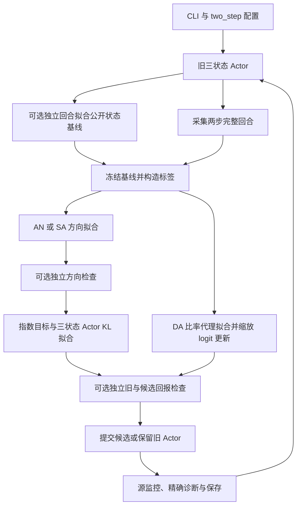

# 两步协作环境：模块、观测、模型与算法数据流

本文对应 T-V 固定方向方差诊断与 T-L 多轮学习。实现集中在本目录，无独立的两步包；P 系列的说明见[成对协作模块说明](../pair_coordination/模块组成说明.md)。研究设计见[总体实验方案](../../docs/总体实验方案.md)，命令见[公共运行说明](../README.md)。

## 1. 环境与模块组成

`TwoStepGame` 固定两人、两步，每人有动作索引 0/1，对应物理动作 −1/+1；默认折扣为 0.9。

1. 第一步两人同时动作，公开状态变为 $s=a_{1,0}a_{2,0}$，奖励 $r_0=0.15s$。
2. 第二步两人读取公开状态 s，奖励 $r_1=0.7s(a_{1,1}+a_{2,1})/2+0.3a_{1,1}a_{2,1}$，随后真终止。

优化回报为 $r_0+\gamma r_1$。第一步会影响第二步的状态和未来价值，因此不能按两次独立的一步成对游戏处理。

| 模块 | 职责 |
|---|---|
| [../registry.py](../registry.py)、[../cli.py](../cli.py) | 注册 T-V/T-L、合并配置并按训练种子分派 |
| [environments.py](environments.py) | `TwoStepGame`，完整回合采样、16 条动作路径枚举、精确价值与方向 |
| [training.py](training.py) | `train(..., temporal=True)`，T-L 的 NumPy 多轮学习和源成本账本 |
| [diagnostics.py](diagnostics.py) | `temporal_variance` 执行 T-V；`empirical_update` 生成及检查训练候选 |
| [objectives.py](objectives.py) | AN/SA 记录级目标、梯度和曲率，保留时间轴 |
| [numerics.py](numerics.py) | 时间占用权重、方向拟合、指数目标、KL 拟合、DA 比率代理 |
| [acceptance.py](acceptance.py) | 方向/回报经验检查 |
| [../pair_coordination/models/direction.py](../pair_coordination/models/direction.py)、[../pair_coordination/training/optim.py](../pair_coordination/training/optim.py) | 复用方向表、Adam；完整表 Actor 拟合也复用原成对函数 |

T-L 使用本目录自己的两步循环；P-L 经过同一入口后转交成对训练器。应用任务的实体网络和共用 Runner 不负责 T-L。

## 2. 观测空间与批次形状

本地输入用三个公开状态索引表示：

| 状态索引 | 含义 | 初始 +1 动作概率 |
|---|---|---:|
| 0 | 第一步，尚无公开 s | 0.65 |
| 1 | 第二步，s=+1 | 0.75 |
| 2 | 第二步，s=−1 | 0.35 |

两人共享策略表，并在同一时刻读取相同公开索引，各自独立采样动作。Actor 不直接读取另一个人的当前动作；第二步可读取的是第一步联合动作产生的公开乘积。没有位置、实体列表、历史编码或集中隐藏状态。

设 E 为完整回合数；时间轴 T=2，人数轴 N=2。

| 批次字段 | 形状 | 含义 |
|---|---|---|
| `x` | `[E,2,2]` | 每步、每人的公开状态索引 |
| `actions` | `[E,2,2]` | 两动作索引 |
| `old` | `[E,2,2]` | 旧策略动作 +1 的概率 |
| `rewards` | `[E,2]` | 团队 r0、r1 |
| `returns` | `[E,2]` | `[r0+gamma*r1, r1]` |
| `exact_advantage` | `[E,2]` | 精确联合动作优势，不是单人条件优势 |
| `weights` | `[E,2,2]` | $\gamma^t/(E\cdot2\cdot(1+\gamma))$ |

时间折扣和智能体平均已包含在 `weights` 中，所有权重总和为 1。拟合时可以展平时间轴适配旧函数，但方差统计和回合重采样保留完整回合分组。

## 3. 模型结构与学习标签

| 模型 | 实现 | 参数及输出 |
|---|---|---|
| Actor | 三状态 Bernoulli 概率表 | 3 个独立状态 logit，保存为长度 3 的 +1 概率数组 |
| 方向 | `TableDirection(3,q_bound)` | 3 个参数，$c_x=q_{max}\tanh(u_x)$，每状态 $q=(-c_x,c_x)$ |
| MC 基线 | `fit_baseline` 的公开状态表 | 3 个值，用独立完整回合的 return-to-go 均值拟合；未采到的状态回退至整批均值并记录 |
| 精确价值 | `TwoStepGame.state_values` | 由旧概率表解析计算 3 个状态价值，仅用于声明的 oracle 标签组及诊断 |

这里没有 hidden 层、attention 或 GRU；应用配置的 `hidden/heads/relation_layers/critic_steps` 不决定 T-L 的模型大小。基线是直接求样本均值，不用神经网络优化器训练。

`configured_labels` 按场景映射标签别名：

| 配置标签 | T-V 固定诊断 | T-L 学习 |
|---|---|---|
| `exact` | `exact_advantage` | 单列 oracle 学习组 |
| `mc` | 完整 MC return 减精确旧状态价值 | 完整 MC return 减独立拟合并冻结的状态表基线 |
| `mc_zero` | 不减基线的完整 MC return | 不减基线的完整 MC return |

精确优势第一步为 $r_0+\gamma V(s_1)-V(s_0)$，第二步为 $r_1-V(s_1)$。MC 标签第一步包含真实采样的 r1，不能替换成期望未来价值；这一区别也是 T-V 方差比较的来源。

## 4. T-L 算法数据流

1. 每个方法、标签组、训练种子单独初始化概率表及成本账本。`mc` 组先用独立回合拟合基线，再采训练回合。
2. 旧 Actor 采集完整两步轨迹，冻结对应概率、基线及标签。第二步后真终止，没有应用导航式的截断自举。
3. AN/SA 复用成对方向拟合器；对 $f=q(a)-\mathbb{E}_{\mu}q$，AN 的二次项为 $q^\top Fq$，SA 为 $f^2$，均减去 $2Af$，按 `weights` 汇总。
4. 开启方向检查时，用另一个旧策略完整回合批次检查方向分数；不通过则不提交新策略。
5. 构造 $p^*_x=\sigma(\operatorname{logit}(p_x)+2\eta c_x)$，按训练占用权重最小化前向 $KL(p^*\Vert p_\theta)$，得到实际候选。极小概率裁剪是数值保护。
6. DA 先拟合未裁剪的旧策略概率比代理，再将所得 logit 差按 `step_sizes` 缩放形成候选；不训练方向函数，也不使用 PPO clip。
7. 回报检查对旧/候选使用共同随机种子产生配对完整回合；两个策略的采样均计费。按 `return_tolerance` 接受或尝试下一步长。
8. 接受候选后进行独立源监控，保存辅助 best。精确源回报、实际回报变化及 KL 是日志诊断，不在 `empirical_update` 中选择普通 MC 候选。

T-V 不进行这套多轮循环。`temporal_variance` 在固定旧策略处比较三组标签与 AN/SA 的回合级分数方差，并另外比较每批重新拟合后的方向误差；固定方向系数为 `[0.4,0.9,-0.6]`。不能把逐智能体记录当作独立完整回合。

## 5. 配置、输出与维护

配置从 `../configs/defaults.json`、`two_step.json`、profile、覆盖文件及命令参数合并。T-V 用 `labels`，T-L 用 `learning_labels`；实际标签组以解析后的配置和运行 manifest 为准。`direction_steps/actor_fit_steps` 在这里是优化步数，区别于应用 Runner 中的 epoch。

一个完整回合消耗 2 个联合环境步，不是 4 步；两人的动作数另列为 agent decisions。训练、独立基线、检查、源监控都计入源预算，最终报告另计。当前没有 T-L 跨人数主实验。

| 输出 | 用途 |
|---|---|
| `training.csv` | 逐更新成本、接受原因、监控和精确回报诊断 |
| `diagnostics.csv` | T-V 固定基点诊断 |
| `evaluation_episodes.csv` | final 策略的完整回合报告 |
| `checkpoints/final.npz`、`best_source.npz` | 概率表及方法、标签、种子、步数等；不是完整续训状态 |
| 外层 `manifest.json/summary.csv/analysis.md` | 运行配置、跨种子汇总与解释 |

修改奖励、状态转移或精确价值时应核对 `environments.py` 的 `_batch/state_values/oracle`；修改数据权重和优化目标看 `objectives.py/numerics.py`；修改完整训练循环及计费看 `training.py`；修改方差问题看 `diagnostics.py::temporal_variance`。主报告用 final，不能由精确诊断优势组推断实际应用可获得同样标签。
