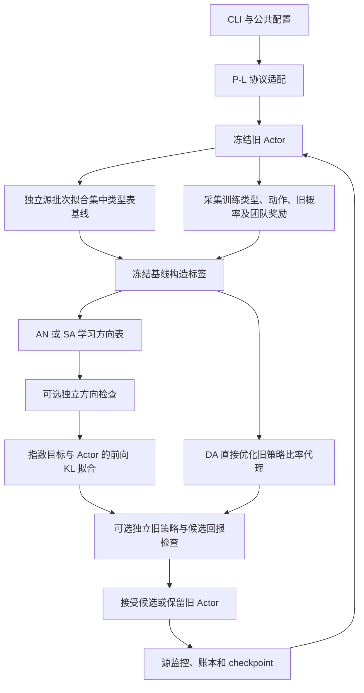

# 成对协作环境：模块、观测、模型与算法数据流

本文描述当前可执行实现，覆盖自身类型协议的 P-E/P-A/P-EA/P-T/P-I/P-L/P-B，以及另行授权完整同伴类型名单的 P-TB。研究问题见[总体实验方案](../../docs/总体实验方案.md)，启动命令见[公共运行说明](../README.md)。P-I 使用单独的三类型信息诊断变体，不能与主环境的二类型观测混用。

## 1. 环境与模块组成

主环境每回合只有一次联合动作。源规模固定为 4 人；每人类型独立取 −1/+1，正类型概率默认 0.6；动作索引 0/1 对应物理动作 −1/+1。团队奖励为：

$$
R=\sum_i b(x_i)a_i+w_n\sum_{i<j}a_i a_j,
\qquad b(-1)=-0.1,\quad b(+1)=0.2.
$$

`normalized` 使用 $w_n=2/(n-1)$；`fixed-edge` 在目标人数变化后仍保留源边权 $2/3$；`composition` 改变目标类型比例。训练优化团队总回报，人均回报仅另列展示。

| 模块 | 当前职责 |
|---|---|
| [../registry.py](../registry.py) | 注册 P 系列实验及依赖，P-EA 依赖已有 P-E |
| [../finite/environments.py](../finite/environments.py) | `PairGame`：有限采样、奖励、枚举与精确真值 |
| [envs/pair_coordination.py](envs/pair_coordination.py) | 恢复的成对环境、类型采样及团队奖励，用于 P-L 训练 |
| [current_protocol.py](current_protocol.py) | 将公共配置映射为 P-L 的 `PairConfig/TrainConfig`，汇总日志和冻结评价 |
| [training/runner.py](training/runner.py) | P-L 多轮训练、独立基线、候选更新、检查和保存 |
| [models/actor.py](models/actor.py)、[models/direction.py](models/direction.py)、[models/critic.py](models/critic.py) | 类型表 Actor、有界方向表、集中类型表基线 |
| [models/torch_models.py](models/torch_models.py) | 训练时的 float64 PyTorch 封装，兼容 JSON 权重 |
| [../finite/diagnostics.py](../finite/diagnostics.py)、[../finite/numerics.py](../finite/numerics.py) | 固定基点机制诊断、方向拟合及 Actor 拟合适配 |
| [../finite/linked_realization.py](../finite/linked_realization.py) | P-EA 读取已经估计的方向，检验其进入 Actor 后的效果 |
| [../applications/envs/pair_entities.py](../applications/envs/pair_entities.py) | P-TB 的完整同伴类型实体协议，复用 `PairGame` 奖励 |

P-L 从 `finite/training.py` 转交本目录的训练器；固定基点诊断由 `finite/` 组织；P-TB 使用 `cooperative_navigation/` 共用 Runner，三者的调用路径不同。

## 2. 观测空间与数据形状

设 $E$ 为回合数、$N$ 为人数。二类型顺序为 `[负类型, 正类型]`，二动作顺序为 `[−1,+1]`。

| 数据 | 形状 | 信息范围 |
|---|---|---|
| Actor/方向输入 `local_types` | `[E,N]`，元素为 0/1 | 每名智能体只按自身类型查询 |
| 策略表 | `[2,2]` | 每种自身类型对应两动作概率 |
| 采样动作 | `[E,N]` | 本回合每人的动作索引，属于训练记录 |
| 旧动作概率 `old_probs` | `[E,N,2]` | 冻结旧 Actor 对采样类型的概率 |
| 团队奖励和学习标签 | `[E]` | 每个回合一个团队标量，供训练使用 |
| 集中 Critic 的输入 | `[E,N]` 完整类型向量 | 训练可读取所有人的动作前类型；Actor 不读取它 |

`finite/` 的统一接口另外保留时间轴：`x/actions/old` 为 `[E,1,N]`，其中 `old` 只存动作 +1 的概率；`returns/rewards/exact_advantage` 为 `[E,1]`。适配层再转为恢复训练函数所需格式。

主协议没有位置、速度、任务时钟、同伴名单或历史窗口。P-I 单独允许自身三类型及同伴类型多重集，比较完整名单、均值与数量、排序截断等固定预处理造成的信息损失；当前是精确映射诊断，不是另一个已经训练好的实体模型。

### P-TB 完整名单分支

P-TB 的物理奖励与主环境一致，但 Actor 的信息权限不同。单步字典观测为：

| 字段 | 联合观测形状 | 字段定义 |
|---|---|---|
| `self` | `[N,3]` | 自身类型两维 one-hot、剩余时间 `1-t` |
| `entities` | `[N,N-1,6]` | `is_peer`、未用类型位、两个零坐标、同伴类型两维 one-hot |
| `mask` | `[N,N-1]` | 所有真实同伴记录均有效 |
| 集中 `state` | `[2N+1]` | 所有类型 one-hot 展平、剩余时间 |

源 N=4 时每人 3 条同伴记录，集中状态为 9 维。没有同伴本次动作或实体 ID；实体顺序由集合网络处理。该分支使用共享 `EntityEncoder`，Actor 输出 2 动作概率，方向输出 2 动作分数，集中 Critic 为 MLP。模型细节可对照[导航模块说明](../cooperative_navigation/模块组成说明.md)的实体编码部分；P-TB 默认单帧，不采用导航的 8 帧历史。

P-TB 配置映射设置自身/实体/动作维度为 `3/6/2`。训练内部经 `EntityTask.flatten → History → entity_input` 编码及解码：当前单帧每人宽度为 $2+6(N-1)+6+1$，N=4 时为 27；最后一项为时间，前面的附加项为上一动作及有效标记。

## 3. 模型结构

| 模型 | 当前 P-L 结构 | 输出与用途 |
|---|---|---|
| Actor | 每种类型一个独立 logit，共 2 个参数 | $p(+1\mid x)=\beta/2+(1-\beta)\sigma(z_x)$，负动作概率为 $1-p$ |
| 方向 | 每种类型一个独立参数，共 2 个参数 | $c_x=q_{max}\tanh(u_x)$，$q(x)=(-c_x,c_x)$ |
| Critic | `TableCritic`，源规模下 $2^4=16$ 个类型组合表项 | 独立基线批次内按完整类型组合平均团队奖励；缺失组合为 0，并按回报界裁剪 |

`current_protocol.py` 固定 P-L 的 Actor/方向为 `table`，初始 +1 概率为 `[0.3,0.7]`，Actor 的 `beta=1e-12`。公共应用参数 `hidden/heads/relation_layers` 不改变这里的类型表结构。目录中的 MLP Actor/方向保留给底层入口，不是当前 P-L 矩阵的默认网络。

P-A/P-EA 另比较完整类型表与“所有类型只能共享一个 logit 偏移”的受限 Actor，并改变拟合步数。受限类用于检验参数实现能力，不应当作主 P-L 的网络结构。

## 4. 算法数据流

1. 冻结旧 Actor。`mc` 学习标签映射为独立学习基线：先用另一个源批次拟合 `TableCritic`；`mc_zero` 则不减基线。P-L 不用精确优势作为学习标签。
2. 用旧 Actor 收集训练批次，令标签为团队奖励减去冻结基线。基线只改变训练标签，不进入部署观测。
3. 对 $f=q(a)-\sum_b\mu(b)q(b)$，AN 最小化 $q^\top F(\mu)q-2Af$，SA 最小化 $f^2-2Af$。解析项为动作分数在旧分布下的方差。两种方法保持其余拟合设置一致。
4. 开启方向检查时，另采独立旧策略回合，检验方向分数；不通过则保留旧 Actor。
5. 构造 $\pi^*(a\mid x)\propto\mu(a\mid x)\exp(\eta q(x,a))$，用训练批次的类型占用权重最小化 $KL(\pi^*\Vert\pi_\theta)$。实际 Actor 受概率混合下界及有限拟合步数约束。
6. DA 不训练方向表，直接拟合 $-\mathbb{E}[A\pi_\theta(a)/\mu(a)]$；需要重试时降低候选拟合学习率。它不是 PPO clip 目标。
7. 回报检查使用独立源样本比较旧 Actor 与候选，按检查开关决定是否筛选。接受后提交；源监控仅按源表现选辅助 best。

固定基点路径不进行上述连续学习循环：P-E 比估计误差；P-A 比方向实现；P-EA 从已有 P-E 读方向；P-T 在声明目标变体上比冻结候选；P-B/P-I 用有限例子诊断边界。精确枚举和 oracle 用于诊断，不在普通 MC 训练中代替采样标签。

## 5. 配置、输出与修改位置

配置合并顺序为 `defaults.json → pair.json（P-TB 为 pair_entities.json）→ profiles.json → --config → CLI/实验覆盖`。预算按实际联合环境步核算；本环境一步一个回合，训练、独立基线、检查和源监控都计入源成本，最终报告另计。

| 要修改的内容 | 位置 |
|---|---|
| 主源奖励、类型分布和目标变体 | `../finite/environments.py` 与 `envs/pair_coordination.py`，核对二者一致 |
| 当前 P-L 表模型、初始策略、标签和适配 | `current_protocol.py` |
| 方向目标、Actor 拟合、DA 代理和接受规则 | `training/direction_loss.py`、`actor_fit.py`、`policy_gradient.py`、`acceptance.py` |
| 固定基点拟合及诊断 | `../finite/numerics.py`、`diagnostics.py` |
| P-TB 信息字段 | `../applications/envs/pair_entities.py` |

P-L 使用 `final.json/best.json`，保存恢复所需训练字段；P-TB 使用应用训练器的 `final.pt/best.pt`。外层生成 `manifest.json`、`training.csv`、`evaluation_episodes.csv` 和汇总；底层事件记录由适配层汇总。主结果使用 final，目标只执行 Actor、不拟合目标 Critic、不按目标成绩选源模型。

自身类型协议在人数变化后仍只有两种输入；P-TB 的完整名单长度直接暴露人数，目标输入支持可能不同。二者的跨规模证据应分开解释。
