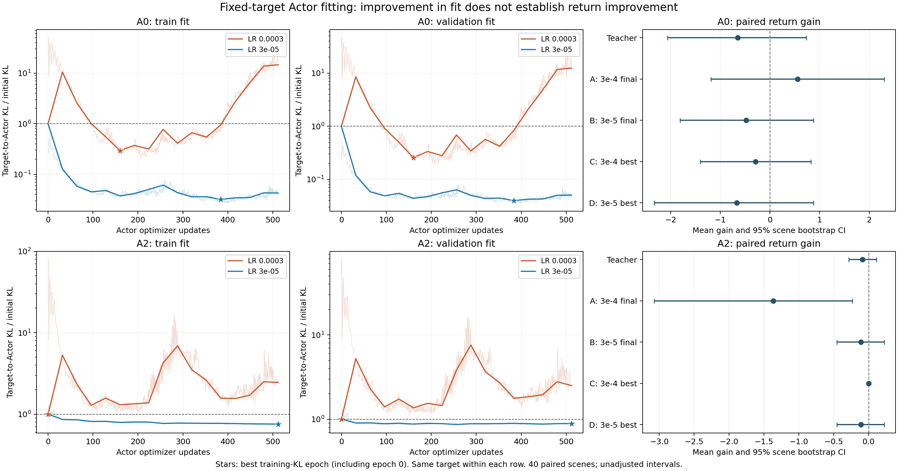

# E1 固定目标 Actor 拟合结果分析

日期：2026-10-17。分析对象为 `a0_s40_u128` 和 `a2_s41_u512`。本次只读取已有结果，没有重新采样、训练或修改算法。

**结论：小学习率和最佳候选选择在拟合这一环确实有效，A0 的改善尤其明确；但本轮没有证明任务回报提高。随后已完成新数据确认、教师复核和短训练；拟合改善仍不能等同于任务收益，也不能把全部性能问题都归因于 Actor。**



图中 KL 均除以各自初始值，低于 1 表示比旧 Actor 更接近目标。浅线为逐优化步，实线为 epoch 边界，星号为依据训练 KL 选中的 epoch；验证集不参与选择。右侧为相对旧 Actor 的回报变化及配对场景区间。

## 1. 数据与核对范围

两个运行均为 `completed`，每个实验单元只训练一次方向、生成一个固定目标，再拟合两条 Actor 轨迹。每条轨迹都完成 16 epoch、512 次优化更新。A0 的方向为 N64/U128，A2 为 N64/U512；方向初始化种子均为 40，数据种子分别为 40、41。每组独立验证 32 回合，在场景种子 20261017 上评估 40 回合。fit 模式未按实际 KL 缩放候选。

已核对：

- manifest、汇总 CSV、逐步轨迹、逐场景回报及小型候选文件能够相互对应；每条拟合轨迹都有 512 个逐步记录和含 epoch 0 的 17 个边界记录。
- 两档学习率保存的小批次顺序完全相同，每个 epoch 都是 64 个回合的完整排列；目标哈希一致。缺少目标实体时，这证明记录一致，不能替代目标内容复核。
- 运行记录中的源 checkpoint 哈希与本地源文件一致。`diagnose.py` 和 `actor_fit.py` 的代码哈希在转换为 Windows CRLF 后与运行记录一致，原始哈希差异来自换行符。
- A2 的 `3e-4 best` 参数逐张量等于源 Actor，确实是零更新。A2 的 `3e-5 best` 与 `final` 参数完全相同。其余候选均不同于旧 Actor。
- 所选 epoch 与完整训练 KL 的最小值、候选文件中的 history 一致。未使用验证 KL 或回报重新选候选。
- 从逐场景回报复算均值、配对增益和原程序的 5,000 次 bootstrap 区间，与原 CSV 一致。重复评估记录也与被复用的记录一致。

**缺少的是两个 `fixed_targets/*.pt` 完整快照；四个约 3.9 MB 的 `fit_candidates/*.pt` 和源 checkpoint 在本地可读。** 因而可以做上述统计、参数相等性和记录核对，但不能重新前向计算目标 KL、验证固定目标内容或逐步重放非零候选。本轮没有重新验收正式 Runner 的参数提交过程。完整快照应继续保留在训练机器或其他备份中，不必为这次统计分析上传 GitHub。

与历史补测核对后：A0 的旧学习率 17 个 epoch 边界训练/验证目标 KL 完全一致；A2 两档学习率的 1,058 行训练/验证目标 KL 完全一致。初始 old→old KL 仅有约 1e-21 以下的数值差异。因此它们是已知设置的复现，不能算新的独立数据重复。本轮主要新增证据是 **A0/U128 的小学习率轨迹、候选保存核对，以及新场景集上的原始教师和各候选回报**。

## 2. A0：目标实现明显改善，且不是靠零更新

训练初始 KL 为 `6.015584e-6`，验证初始 KL 为 `6.645545e-6`。下表中 100% 表示旧 Actor 的拟合误差，越低越好。最后一列为验证状态上的 `KL(旧 Actor || 候选)`。

| 组别 | 学习率与选择 | 所选 epoch | 训练误差 / 初始 | 验证误差 / 初始 | 实际策略 KL（×1e-6） |
|---|---|---:|---:|---:|---:|
| A | 3e-4，最终 | 16 | 1463.72% | 1238.66% | 87.9009 |
| B | 3e-5，最终 | 16 | 4.27% | 5.06% | 6.1320 |
| C | 3e-4，最佳 | 5 | 29.41% | 25.70% | 8.7040 |
| D | 3e-5，最佳 | 12 | 3.19% | 4.00% | 6.9541 |

这组结果区分了两个作用：

1. **降低学习率让优化轨迹本身更好。** 原学习率首步训练误差为初始的 50.17 倍，512 步中有 220 步比旧 Actor 更差；小学习率首步为初始的 0.262 倍，512 步全部低于初始误差。
2. **最佳选择保留已经出现的进展。** 原学习率在 epoch 5 已拟合较好，最终又明显退化。小学习率在 epoch 12 达到最佳，之后也有小幅反弹。对小学习率，最佳选择进一步把验证残差从 `3.365093e-7` 降到 `2.658189e-7`，约下降 21%。

D 组验证拟合误差相对旧 Actor 降低约 96%，所选 epoch 为 12，参数确实改变。教师实际 KL 为 `6.646986e-6`，D 的实际 KL 为 `6.954108e-6`，两者量级接近。这支持“Actor 能较好实现这个固定目标”，也排除了“本次改善全靠选回旧 Actor”。但 E1 没有匹配各候选实际 KL，不能据此排除更新幅度对回报的影响。

## 3. A2：零更新保护正确，小学习率有改善但仍不充分

训练初始 KL 为 `2.325738e-6`，验证初始 KL 为 `2.216007e-6`。

| 组别 | 学习率与选择 | 所选 epoch | 训练误差 / 初始 | 验证误差 / 初始 | 实际策略 KL（×1e-6） |
|---|---|---:|---:|---:|---:|
| A | 3e-4，最终 | 16 | 245.34% | 249.80% | 4.2006 |
| B | 3e-5，最终 | 16 | 75.47% | 88.87% | 0.5508 |
| C | 3e-4，最佳 | 0 | 100.00% | 100.00% | 约 0 |
| D | 3e-5，最佳 | 16 | 75.47% | 88.87% | 0.5508 |

原学习率首步训练误差为初始的 79.27 倍，512 步全部比旧 Actor 差，选择 epoch 0 符合定义。小学习率仅有 12 步比初始更差，最终产生非零候选，但验证误差只减少约 11.13%，仍保留初始误差的 88.87%。这组还不能说目标已经被充分实现。

小学习率的最佳点就在最后，所以 B、D 是同一个策略，最佳选择没有额外收益。不能把两行相同候选算成两次独立成功。A2 的目标、方向预算与源 Actor 都不同于 A0，二者拟合难度的差异不能单独归因于 U512。

## 4. 拟合改善尚未转化成可靠回报提升

下表为 `候选 J − 旧 Actor J`，正值表示提高。J 是执行时实际奖励形成的折扣回报，不是 Critic 预测。区间采用逐场景配对 bootstrap，统一随机种子、50,000 次重采样，以便相同策略得到相同区间。原程序的 5,000 次区间也已复算通过，判断不变。

| 候选 | A0 平均增益 [95% 区间] | A2 平均增益 [95% 区间] |
|---|---|---|
| 原始教师目标 | -0.648 [-2.062, 0.732] | -0.087 [-0.284, 0.115] |
| A：3e-4 最终 | +0.555 [-1.193, 2.302] | -1.366 [-3.075, -0.232] |
| B：3e-5 最终 | -0.478 [-1.813, 0.878] | -0.112 [-0.455, 0.223] |
| C：3e-4 最佳 | -0.291 [-1.405, 0.827] | 0 [0, 0]，同旧 Actor |
| D：3e-5 最佳 | -0.668 [-2.337, 0.881] | -0.112 [-0.455, 0.223]，同 B |

两个单元中，每个候选和旧 Actor 的成功数均为 0/40。

- **A0 的拟合越准，没有对应更高的回报点估计。** 原始教师本身也没有显示可靠正收益；D 与教师的回报差为 -0.020，区间 [-0.829, 0.777]。因此，本轮不能把剩余问题继续全部推给 Actor，也不能用这 40 个场景断言教师必然无效。
- **A2 原学习率末轮候选存在下降信号。** 其相对旧 Actor 的配对区间完全在零以下；小学习率最终候选相对它提高 1.254，区间 [0.197, 2.818]。这支持“减少拟合过程造成的损失”，但小学习率相对旧 Actor 仍没有确认正收益。
- **最佳训练 KL 不是最佳回报。** 本轮正是按预先规定的拟合规则选择，没有依据回报改选；不能看到 A0 的 A 组点估计最高，就事后把它定义为正确方向。

这些是单个固定源模型、固定目标条件下的场景区间，未经多重比较校正；不是跨训练种子的算法置信区间。A0、A2 使用相同场景集但不同源模型及动作随机种子，不合并为 80 个独立算法重复，也不与旧 MAPPO 的另一组场景均值直接作显著性比较。

方向代理分数也提醒我们保留疑问：A0 的训练 B 为 `0.0039813`，验证 B 为 `0.0000741`；A2 的训练 B 为 `0.0006966`，验证 B 为 `-0.0000228`。这些基于冻结 Critic 的 GAE 标签，不能替代真实优势或执行收益。当前只支持“方向的泛化和价值仍待检验”，不能据此宣称方向网络已经被证伪。

## 5. 成本与记录注意事项

两个单元合计 476,800 环境步，其中数据采集 76,800、实际评估 400,000；方向优化 640 次、Actor 优化 2,048 次。运行耗时合计约 3.88 小时。

A0 评估了旧 Actor、教师和四个不同 Actor，共 6 个策略；A2 实际评估 4 个不同策略，旧 Actor 与零更新、低学习率 final 与 best 分别复用。直接累加两份逐场景 CSV 的全部行会误算成 480,000 评估步，正确值为 400,000。`diagnostics.csv` 中 final/best 共享的 512 次拟合更新及耗时也不能重复相加。

零更新没有免去方向和 Actor 拟合成本。这次逐优化步都执行整批诊断，记录的 `fit_seconds` 包含高频监控开销，不能直接用来比较正常训练的 AN/MAPPO 速度。

A2 的低学习率 final/best 在原 CSV 中区间略有差异，原因是原 bootstrap 种子包含候选名称；逐场景回报和参数完全相同。本分析图表使用共享重采样索引消除这种纯 Monte Carlo 差异，未修改原始 CSV。

## 6. 后续实验状态

A0 数据种子 43/44 确认、固定教师复核及 N64 四格短训练均已完成。小学习率的拟合改善仍限定于相应固定目标；不从本报告推广为全程使用 3e-5。

[当前六组实验方案](../../../../notes/导航采样量与学习率六组实验方案_20261019.md)。旧行动建议已移至[历史执行建议](../../../../archive/notes/历史执行建议_20261019.md)，本节不再作为待执行清单。

## 原始资料与复算

- A0：[运行记录](../a0_s40_u128/manifest.json)、[候选指标](../a0_s40_u128/diagnostics.csv)、[逐步轨迹](../a0_s40_u128/fit_trace.csv)、[逐场景回报](../a0_s40_u128/evaluation_episodes.csv)、[方向代理分数](../a0_s40_u128/direction_scores.csv)。
- A2：[运行记录](../a2_s41_u512/manifest.json)、[候选指标](../a2_s41_u512/diagnostics.csv)、[逐步轨迹](../a2_s41_u512/fit_trace.csv)、[逐场景回报](../a2_s41_u512/evaluation_episodes.csv)、[方向代理分数](../a2_s41_u512/direction_scores.csv)。
- [分析脚本](analyze.py)、[数值结果与来源哈希](metrics.json)。脚本需要本地已有的四个候选文件和两个源 checkpoint，不需要缺失的完整固定目标快照。

从仓库根目录复算：

```powershell
python manifold_project/experiments/results/evidence/navigation/actor_fit_e1_20261017_v1/analysis_20261017/analyze.py
```
