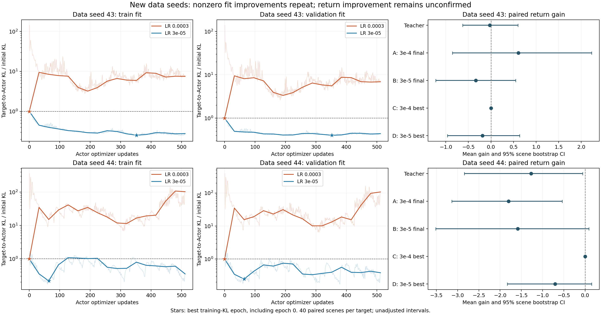

# A0/N64/U128：数据种子 43、44 确认结果

日期：2026-10-18。本次读取已有 CUDA 诊断结果，没有重新采样、训练、修改候选选择或改动原始结果。

**结论：两个新数据种子都复现了小学习率下的非零验证拟合改善，最佳选择也保留了中途进展。但任务回报仍没有确认提高，seed 44 的教师目标在发现阶段出现负向信号；其后的独立复核未确认该负收益，见下文后续状态。**



曲线纵轴为各自的目标到 Actor KL 除以初始值，低于 1 表示比旧 Actor 更接近目标。浅线为逐优化步，实线为 epoch 边界，星号依据训练 KL 选择；验证集和回报不参与选择。右侧为相对旧 Actor 的配对回报增益。

## 1. 这批数据能够验证什么

两个单元都使用同一个 A0 源 checkpoint（训练种子 40、round 545），方向初始化种子 40，训练数据种子分别为 43、44。每个单元训练 64 回合、验证 32 回合，方向更新 128 次，Actor 每档学习率完成 16 epoch、512 次更新。评估场景种子为 20261018，每个候选评估 40 回合。

读取并交叉核对了 manifest、10 行候选汇总、2,116 行拟合轨迹、480 行逐场景逻辑记录、四个候选参数文件和源 Actor：

- 状态为 completed，预算及参数与给定命令一致；源 checkpoint 的 SHA256 匹配。
- 两档学习率在同一个种子内记录相同目标哈希，保存的小批次顺序相同，每个 epoch 都完整排列 64 个回合。
- 每条轨迹均含初始点、512 个逐优化步记录、16 个 epoch 结束记录；候选文件的 history 与 CSV 一致。
- 最佳 epoch 与训练 KL 最小值一致。两组 `3e-4 best` 参数逐张量等于旧 Actor；两组 `3e-5 best` 参数均不同于旧 Actor。
- 逐场景均值、配对回报增益和原程序 5,000 次 bootstrap 区间均可复算，复用旧 Actor 的评估记录一致。
- `diagnose.py` 和 `actor_fit.py` 转换为 CRLF 后与运行代码哈希匹配，换行符差异不代表算法变更。

完整 `fixed_targets/*.pt` 仍未同步，本地不能重新前向计算目标 KL、验证目标内容或逐步重放拟合；目标哈希与元数据一致不等于已完成内容复核。此处的非零候选 KL 结论来自相互一致的日志，零更新与参数是否改变则直接核对了 `.pt`。完整快照应保留在训练机器或备份中。

43、44 是两个新采样数据单元，不是两个独立完整训练种子。两组共享评估 reset 场景，动作随机数随数据种子改变，因此也不能把它们简单拼成 80 个独立场景。下文分别报告，没有合并制造总体显著性。

## 2. Actor 拟合改善通过了这次新数据确认

下表为验证拟合误差占旧 Actor 初始误差的百分比，100% 为零更新基准，越低越好。

| 设置 | seed 43 | seed 44 |
|---|---:|---:|
| A：3e-4，最终 | 692.50% | 10860.82% |
| B：3e-5，最终 | 43.99% | 38.21% |
| C：3e-4，最佳 | 100%，epoch 0 | 100%，epoch 0 |
| D：3e-5，最佳 | **40.38%，epoch 11** | **24.60%，epoch 2** |

原学习率在两个种子中的 512 个优化后检查点全部比初始训练误差更差，首步分别达到初始的 143.83、359.54 倍。因此选回旧 Actor 是正确保护，不能算学到了有效更新。

小学习率最佳候选在两组中的验证误差分别降低约 **59.6% 和 75.4%**，均为真实非零更新。它们的实际策略 KL 分别为 `1.563286e-6`、`8.588164e-7`，对应教师 KL 为 `2.360009e-6`、`9.407884e-7`。这排除了“所有改善都来自选回旧 Actor”，但 E1 没有匹配实际 KL，不能排除更新幅度对回报的影响。

最佳选择相对小学习率最终候选，进一步降低验证残差约 **8.2% 和 35.6%**。seed 44 在第 2 个 epoch 就到达最佳，后面仍出现明显震荡；单独降低学习率没有消除末轮退化。最终保留第 2 轮参数，但仍完成并计费全部 512 次更新，不能把计算成本记成 64 次。

连同开发阶段 A0 seed 40 的验证残差 4.00%，目前三个 A0 固定目标都得到非零验证改善；其中只有 43、44 是本次预先选定的新数据确认。改善幅度差异较大，43、44 仍保留约 40% 和 25% 的初始残差，所以结论是“改善可重复”，不是“Actor 已经精确实现所有目标”。此前 A2 seed 41 的残差仍约 88.87%，也应继续保留在完整证据中。

## 3. 回报仍未显示修复收益，seed 44 教师值得优先复核

下表为 `候选 J − 旧 Actor J`，正值表示提高。J 是实际执行奖励形成的折扣回报。为使相同策略得到相同区间，统一使用 50,000 次配对场景 bootstrap；原程序的 5,000 次结果已独立复算通过。区间未经多重比较校正。

| 候选 | seed 43 平均增益 [95% 区间] | seed 44 平均增益 [95% 区间] |
|---|---|---|
| 原始教师目标 | -0.028 [-0.627, 0.599] | **-1.273 [-2.842, -0.059]** |
| A：3e-4 最终 | +0.609 [-0.855, 2.230] | -1.800 [-3.139, -0.538] |
| B：3e-5 最终 | -0.334 [-1.221, 0.549] | -1.583 [-3.513, 0.088] |
| C：3e-4 最佳 | 0 [0, 0]，同旧 Actor | 0 [0, 0]，同旧 Actor |
| D：3e-5 最佳 | -0.190 [-0.964, 0.634] | -0.708 [-1.830, 0.155] |

每组旧 Actor、教师和所有候选均为 **0/40 成功**。

因此，拟合改善还不能等同于任务性能改善。seed 44 的 D 相对 A 平均提高 1.092，但直接配对区间为 [-0.341, 2.580]；D 相对 B 提高 0.876，区间为 [-0.554, 2.649]。这些点估计有改善迹象，但本轮尚未确认正收益。seed 43 的 A 点估计最高，区间仍跨零，不能根据这个点估计事后改选模型。

### seed 44 的负向教师信号有多可靠

原始教师直接执行，不经过 Actor 拟合，因此它的负向表现不能由 Actor 拟合误差解释。但这仍不足以断言方向普遍有害：

- 40 个配对回合中，教师改善 15 个、下降 24 个、近似不变 1 个，中位数变化仅为 -0.0023。
- CSV 的 episode 30、8 分别贡献 -21.706 和 -17.021 的回报差，合计占净负差总和约 76.1%。这是偏斜结果的重要组成，不能删除或改记为异常值。
- 删去任意一个回合后的均值仍为负，但常见配对 t 区间为 [-2.750, 0.205]，与 bootstrap 在是否跨零上不一致。t 区间也只是近似方法，不替代主报告。

因此应表述为 **需要独立复核的负向信号**，不能写成“已经证明教师有害”。本分析未删除任何场景，也未用敏感性分析改变模型选择。

## 4. 方向代理分数提供了什么线索

| 数据种子 | 训练 B | 验证 B | 验证一阶项 D | tanh 饱和率 |
|---|---:|---:|---:|---:|
| 43 | 0.00027089 | 0.00188288 | 0.00117753 | 0 |
| 44 | 0.00158818 | -0.00026268 | -0.00003727 | 0 |

seed 44 的训练代理分数为正，验证 B 和一阶项 D 均为负，与执行回报的负向信号方向一致。这使“方向在新数据上的泛化、标签质量”值得优先检查；两组饱和率均为零，不支持把这次现象直接归因于 tanh 饱和。

这些代理量使用冻结 Critic 的 GAE 标签，并非真实优势。seed 43 的验证 B 较好，也没有转化为可确认的执行收益。当前不能从代理分数单独区分方向估计方差、Critic 标签偏差、状态分布或步幅影响，更不能把报告改写成某个原因已经确诊。

## 5. 后续复核状态

两个固定教师各 100 对的新评价已经完成，负向信号未得到新的明确支持，正收益也未确认。封顶复核已结束，之后的四格短训练也已完成；不再追加相同目标的复核作为连续训练门槛。

[当前六组实验方案](../../../../notes/导航采样量与学习率六组实验方案_20261019.md)。旧行动建议已移至[历史执行建议](../../../../archive/notes/历史执行建议_20261019.md)，本节不再作为待执行清单。

## 6. 成本、文件与复算

本轮共 476,800 环境步，其中采集 76,800、实际评估 400,000。方向更新 256 次，Actor 更新 2,048 次，耗时约 3.88 小时。每个数据种子的高学习率最佳候选复用旧 Actor 评估，所以 480 行逻辑评估记录不能按 480 个独立回合计费。高频整批诊断包含在拟合耗时内，不能直接当成正常训练速度。

原始资料：[manifest](../a0_s43_44_u128/manifest.json)、[候选指标](../a0_s43_44_u128/diagnostics.csv)、[拟合轨迹](../a0_s43_44_u128/fit_trace.csv)、[逐场景回报](../a0_s43_44_u128/evaluation_episodes.csv)、[方向代理分数](../a0_s43_44_u128/direction_scores.csv)。

复算产物：[数值与输入哈希](metrics.json)、[分析脚本](analyze.py)。历史上下文：[首轮 E1 分析](../../actor_fit_e1_20261017_v1/analysis_20261017/E1结果分析.md)。脚本读取现有候选和源 checkpoint，不需要缺失的固定目标快照。

在仓库根目录执行：

```powershell
python manifold_project/experiments/results/evidence/navigation/actor_fit_e1_confirm_20261018_v1/analysis_20261018/analyze.py
```
