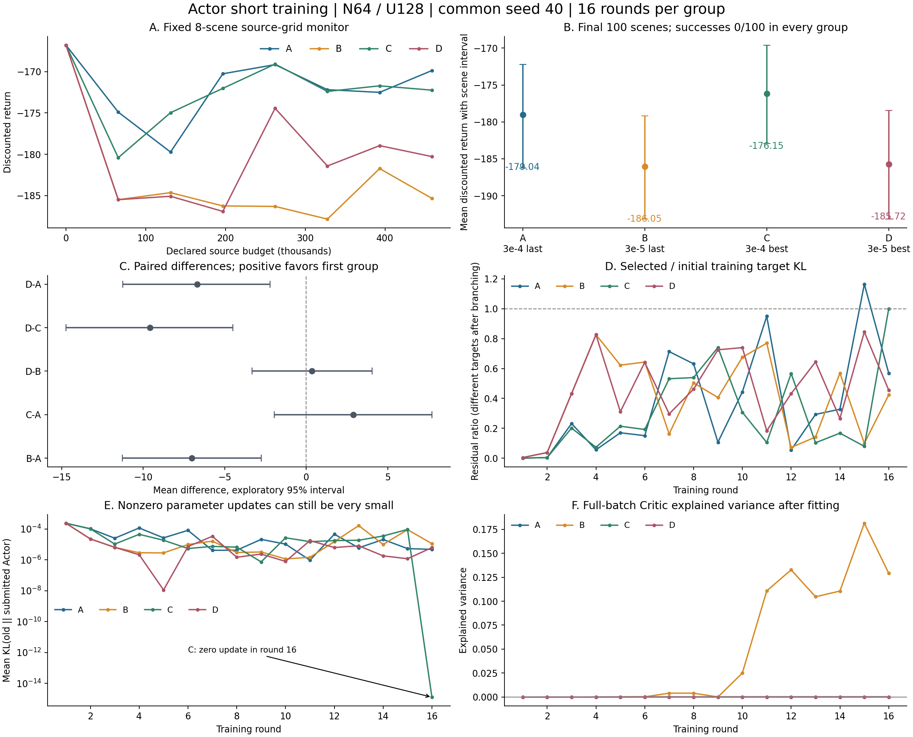

# Actor 四格短训练结果与后续判断

2026-10-19。本轮四组从同一随机初始化、训练种子 40 开始，各完成 16 轮 N64/U128 更新。**目前没有看到 Actor 拟合改进转化为可靠的任务收益。小学习率 3e-5 两组在本轮终点评价中更差；3e-4 加最佳候选选择的 C 组均值最好，但相对 A 组的优势尚未确认。四组成功率均为 0/100。**

这收窄了此前固定目标实验的结论：小学习率能改善某些已训练基点的小目标拟合，不代表从头训练也应统一改用 3e-5。最佳候选选择按定义工作，也没有普遍依赖零更新；当前停滞还需要检查 Critic、标签和方向目标的质量。

## 1. 终点评价结果

以下均使用各组 `final.pt`，同一组 100 个场景、相同动作随机数生成规则，最多 1,000 步。回报越高越好。

| 组别 | Actor 学习率与选择规则 | 最终平均折扣回报 | 成功数 | 参数实际改变轮数 | 选择零更新轮数 |
|---|---|---:|---:|---:|---:|
| A | 3e-4，last | -179.036 | 0/100 | 16/16 | 0/16 |
| B | 3e-5，last | -186.052 | 0/100 | 16/16 | 0/16 |
| C | 3e-4，best_train_kl | **-176.147** | 0/100 | 15/16 | 1/16 |
| D | 3e-5，best_train_kl | -185.719 | 0/100 | 16/16 | 0/16 |

对完整场景配对重采样 50,000 次，分析随机种子 20261019，得到以下探索性 95% percentile bootstrap 区间。差值为前者减后者。

| 比较 | 平均差 | 95% 配对场景区间 | 本轮解释 |
|---|---:|---|---|
| B − A | -7.016 | [-11.271, -2.752] | last 规则下，降低学习率后结果更差 |
| C − A | +2.889 | [-1.957, +7.701] | 最佳候选选择有正向均值，优势尚未确认 |
| D − B | +0.333 | [-3.339, +4.032] | 小学习率下，选择规则未显示明确回报改善 |
| D − C | -9.572 | [-14.734, -4.496] | best 规则下，小学习率组也更差 |
| D − A | -6.683 | [-11.257, -2.212] | 两项结合没有优于原配置 |

这些区间描述四个已训练终点策略在评价场景上的不确定性，未做多重比较校正，不能替代独立训练种子的重复。本轮共有一个共同训练种子，不是四个独立训练重复，也不能把四组 100 回合当作 400 个独立场景。

## 2. 候选选择生效，但回报收益没有随之确认

逐轮检查 `events.jsonl` 中 epoch 0–16 的完整训练 KL，并与 `training.csv` 和最终 checkpoint 的记录对照，选择规则、零更新标记和 512 次拟合预算一致。

- C 组在第 2、3、8、11、13、14 轮选择中间 epoch，第 16 轮选择旧 Actor；其余轮次选择最终 epoch。
- D 组在第 4、5、13、14、15 轮选择中间 epoch，全部 16 轮都提交了非零参数变化。
- A 组有 8 轮的最佳 epoch 早于末轮。第 15 轮末轮残差为起点的 116.43%，并约为该轮最佳残差的 6.01 倍，说明保留中途进展仍有实际用途。
- C 组第 16 轮的末轮候选残差约为起点的 1.634 倍；选择器正确保留旧 Actor，实际 old→Actor KL 约为 1.29e-15。

因此，不能把本轮低表现解释为“选择器一直拒绝学习”。C 只发生一次零更新，D 一次也没有。也不能把 C 比 A 高出的均值全部归因于最后一次回退：两组从第 2 轮提交不同候选后，后续数据与方向目标已经分化。

四组各轮“所选训练 KL / 初始训练 KL”的中位数为 A 26.23%、B 42.79%、C 19.67%、D 44.38%。这是各自轨迹的描述，后续目标不同，不能拿这些比例直接当作同一目标上的优化器排名。

## 3. 为什么与之前小学习率更好的结果不同

之前主要研究已训练 4M Actor 附近的固定目标，本轮研究从随机初始化开始的早期连续学习，两者不是同一个优化状态。

首轮恰好能做严格对照：四组初始监控、训练标签对应的方向统计、初始目标 KL 一致；同一学习率下，A/C 首两轮和 B/D 首四轮的完整拟合轨迹在提交分歧前也一致。

首轮目标→旧 Actor KL 约为 **2.34818e-4**：

| 学习率 | 首轮最终目标 KL | 占初始残差 |
|---|---:|---:|
| 3e-4，A/C | 5.53414e-8 | 0.02357% |
| 3e-5，B/D | 9.71872e-7 | 0.41388% |

在这一个相同目标、相同 512 次更新预算下，3e-4 已经拟合得更好，没有出现此前小目标实验中的严重失控。两种学习率都明显降低残差，但不能从成熟基点的结果直接推出小学习率更适合所有训练阶段。

当前数据也还不能证明 B/D 的回报劣势完全由首轮残差导致，更不能据此直接推出自适应学习率方案。后续采样、Critic、方向与目标相互影响，因果归因需要固定基点和数据的受控比较。

## 4. 更值得排查的训练信号

### 策略在记录的训练输入上仍接近均匀动作分布

五动作均匀分布熵为 ln(5) ≈ 1.609438，最后一轮记录的策略熵分别为：A 1.608845、B 1.609100、C 1.608782、D 1.609152。每轮实际 old→Actor KL 的中位数分别约为 **2.09e-5、9.86e-6、1.80e-5、6.25e-6**。

参数几乎每轮都改变，但变化通常很小，尚未形成明显的动作偏好。这支持“行为学习进展有限”的判断，不等于方向一定错误，也不能只凭熵就认定应该增大 η 或减少探索。

### Critic 的整批解释方差偏低

这里读取 `critic_full_batch` 的 `postfit` 统计，避免把最后一个小批次的指标当成整批结论。

- A、C、D 的 16 轮拟合后解释方差都在零附近；A/C 的最终值分别约为 -1.24e-6、-1.68e-6，D 约为 -1.33e-6。
- B 后期出现一些改善，最高约 0.181，最后约 0.129，但其回报仍较差。
- A 第 16 轮预测均值约 -210.06、目标均值约 -209.86，均值接近，解释方差仍接近零。

这说明至少 A/C/D 在记录的训练批次上没有有效解释价值目标的变化。“主要学到平均值、对状态差异反应弱”是需要验证的假设，尚不能仅凭 EV 证明网络输出为常数或已经找到唯一根因。B 的例子也表明，EV 较高并不自动带来更高回报。

### 方向训练分数并非始终有利，泛化情况未被记录

训练代理分数定义为 `B_label = 2 D_label − fisher_energy`。A/C 的 B 为正；B 在第 6、11 轮为负；D 在第 10、14、16 轮为负，其中第 10、14 轮的 D_label 本身也为负。这表明部分方向连当前训练标签下的局部有利性都不稳定，但不能将代理分数直接当作真实收益。

D 第 13 轮原始 tanh 输出有 78.61% 达到饱和阈值，但有效中心化方向的边界占比为 0，动作跨度约 0.03746。不能把这一轮的原始饱和等同于有效方向处处触顶，更不能用它解释所有组的停滞。

本轮按计划没有开启独立方向验证，也没有保存每轮批次与教师快照。因此无法事后直接测出这 16 个历史教师各自的真实收益或方向泛化。重新采样和训练方向得到的是新目标，不能冒充历史逐轮重放。

## 5. 训练曲线与成本应怎样读

固定 8 个 `source-grid` 监控场景的初始回报均为 -166.796，四组后续同场景监控点都未超过该值。A/C 处于相对较好的水平，B/D 较低，但这些只是 8 场景监控，不能作为总体收益下降的充分证据。

三个评价集合必须区分：中途 `source-grid`、500k 节点的 8 个 `source-final` 场景、最终报告的 100 个场景。图中监控曲线只连接同一 `source-grid` 集合，没有把 500k 不同场景接上去解释为突然下降；终点组间比较使用独立的 100 场景记录。

| 成本 | 每组 | 四组合计 |
|---|---:|---:|
| 训练联合环境步 | 409,600 | 1,638,400 |
| 源监控步数，已计入源预算 | 72,000 | 288,000 |
| 实际源步数 | 481,600 | 1,926,400 |
| 终点评价，另计 | 100,000 | 400,000 |
| 总交互 | 581,600 | **2,326,400** |
| Critic / 方向 / Actor 优化次数 | 5,120 / 2,048 / 8,192 | 20,480 / 8,192 / 32,768 |

每组保留 18,400 步，是因为不足以容纳下一个完整 64×400 步训练批次，不是提前中断。四组都完整结束；记录的实验耗时合计约 **8.21 小时**。C 的零更新轮次照常消耗了全部拟合预算，没有隐藏成本。

此次复算核对了配置仅学习率/选择规则不同、相同记录源码指纹、逐轮候选历史、checkpoint 记录、成本和最终 100 回合统计。分析时对 56 份输入文件留存了哈希，见 [metrics.json](metrics.json)。之后按用户要求移除了 4 张仅标题不同的父级派生概览图；数值记录与模型未变，旧图哈希及保留位置见[清理清单](../../../../notes/maintenance_20261019/cleanup_manifest.json)。四组记录的源码指纹相同，但当前工作区整棵源码树的指纹未匹配到历史记录，不能仅凭这一总哈希声称已独立重建当时所有文件。

## 6. 当前研究判断与下一轮

本轮未确认整体性能提升，也未证明 N64 或方向网络无效。下一轮采用 N16/N32/N64 × 固定/衰减学习率，每组 2M，从共同初始化开始；保持最佳候选选择和各模块 epoch 数。Critic、标签及拟合指标随训练只读记录，不再把独立 Critic 诊断作为续训前置门槛。

[当前六组实验方案](../../../../notes/导航采样量与学习率六组实验方案_20261019.md)。旧行动建议已移至[历史执行建议](../../../../archive/notes/历史执行建议_20261019.md)，本节不再作为待执行清单。
