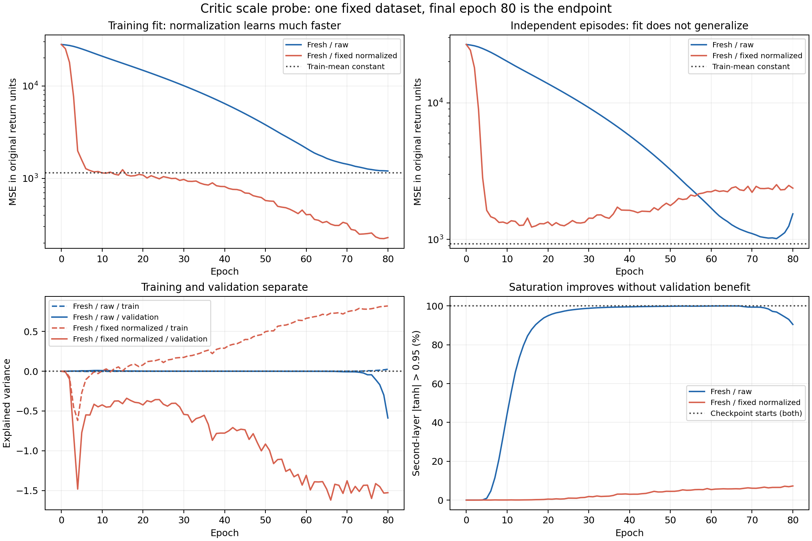

# Critic 价值尺度诊断结果分析

2026-10-22。四个分支均完成。**固定归一化显著改善了新 Critic 的训练拟合与饱和情况，却没有改善独立回合上的预测；已有饱和 Critic 在两个分支中都未恢复状态区分。两个起点均未通过预定筛选，本轮结束，不据此将归一化接入主训练或启动新的 2M 训练。**

需要修正此前的归因：Critic 的数值失效真实存在，但“价值尺度处理 → 避免饱和 → 独立价值预测改善 → 性能恢复”这条链没有通过本次验证。当前更直接的未解问题是固定回报目标的跨回合泛化，不能继续把饱和当作全部学习失败的充分解释。

## 1. 执行与证据核对

冻结新六组 N16 fixed 的 round 272 Actor/Critic，数据种子 45，fresh 初始化种子 40。训练与验证各 32 回合，全部为 400 步截断，无成功终止。实际采样 **25,600 个联合环境步**，四分支各 **1,280 次**、合计 **5,120 次 Critic 优化**；Actor、方向优化与回报评价均为零。记录耗时 **168.47 秒**。

- 源 checkpoint 文件哈希与 manifest 一致，Actor/Critic 参数指纹与固定包来源一致。训练机器的绝对路径不同不影响内容核对。
- 固定包的完整校验和、模型/数值代码指纹通过；归一化训练均值 **−163.9381**、标准差 **33.8661** 可复算，验证集未参与计算。
- 四个候选均引用同一固定包；同起点的初始参数指纹相同。归一化输出变换的初始实际价值误差上限为 fresh **1.71e-5**、checkpoint **3.05e-5**，符合声明容差。
- 拟合轨迹 324 行，四分支各含 epoch 0–80，更新次数均为 16×epoch；逐回合终点误差共 256 行。
- 用 CPU 重新加载四个实际候选复算原始量纲指标，MSE 与 CUDA 记录的最大差约 **1.67e-5**。从冻结旧 Critic、奖励和边界重算价值目标，最大差 **3.05e-5**；GAE 最大差 **2.96e-5**。
- 新增分析没有运行环境或优化器。本目录 12 个原始文件的哈希前后不变，见 [完整复算指标](metrics.json)及[复算程序](analyze.py)。

因此，下述训练/验证分离不支持用“归一化误差没换回原单位”“候选引用了不同数据”或“起点被直接搬到目标均值”解释。

## 2. 预定第 80 epoch 结果

MSE 均为原始回报量纲，越低越好；EV 为解释方差，负值表示误差的方差大于目标方差。EV 不包含整体均值偏差，须与 MSE 一起读取。饱和率为验证状态上第二层 `abs(tanh)>0.95` 的比例。

| Critic 分支 | 训练 MSE | 验证 MSE | 训练 EV | 验证 EV | 验证饱和率 |
|---|---:|---:|---:|---:|---:|
| fresh_raw | 1,200.77 | 1,540.04 | 0.026 | −0.588 | 90.45% |
| fresh_fixed_normalized | **228.69** | **2,373.73** | **0.822** | **−1.528** | **7.28%** |
| checkpoint_raw | 1,146.98 | 928.60 | 约 0 | 约 0 | 100% |
| checkpoint_fixed_normalized | 1,147.74 | 924.99 | 约 0 | 约 0 | 100% |
| 训练均值常数预测 | 1,146.91 | **930.22** | 0 | 0 | 不适用 |

常数参照仅输出训练集的加权目标均值 −163.9381，不使用验证集估计参数。两个 checkpoint 分支输出仍近似常数，其与 930.22 的小差别主要来自常数值的变化，不代表恢复了状态判断。

fresh 归一化分支相对 raw：训练 MSE 降低约 **80.96%**，验证 MSE 却增加 **54.13%**，验证 EV 降低 **0.940**。checkpoint 归一化的验证 MSE 只降低 **0.389%**，EV 基本不变。两者均未达到预先约定的“验证 MSE 降低至少 10%、EV 增加至少 0.05”。

按完整验证回合配对，fresh 归一化的误差在 **28/32** 回合高于 fresh raw。事后描述性 paired percentile bootstrap 的平均 MSE 差为 **+833.69，95% 区间 [−106.95, +1,686.40]**：点估计恶化，但区间跨零，不能表述为跨场景、更不能表述为跨训练种子的普遍有害。

相比训练均值常数，fresh 归一化在 **27/32** 回合误差更高，平均差 **+1,443.51，[+774.14, +2,261.37]**。这些区间采用 20,000 次完整回合重采样，条件是当前固定训练数据和模型；未做多重比较校正，不替代预定终点判据。

## 3. 训练轨迹说明了什么

**归一化改善了这条拟合轨迹的可优化性。** fresh_raw 先花大量更新拟合负值均值，第二层逐渐接近饱和；fresh_normalized 很快降低均值误差，随后能学习训练数据的状态差异。它的训练 EV 从 epoch 20 的 0.080 增至 epoch 80 的 0.822，验证 EV 却从约 −0.424 降至 −1.528。这表现为训练拟合提高、独立回合预测恶化，符合过拟合的现象。

**减少饱和不等于得到正确价值预测。** fresh_normalized 的验证预测方差约 1,040.73，目标方差约 919.08；输出已经会变化，但变化没有对准独立目标。不能只看预测方差非零或训练 EV 高就宣布 Critic 修好。

**改选中间 epoch 也没有在这次轨迹中超过常数参照。** fresh_normalized 全轨迹最低验证 MSE 为 1,232.20（epoch 16），fresh_raw 为 1,014.11（epoch 76），均高于常数的 930.22。这些只是轨迹描述，不用于重新选择提交候选，也不提出新一轮“最佳候选”修复。

**已经饱和的模型没有被救回。** 两个 checkpoint 分支验证预测方差约 1.26e-13、3.61e-14；第二层局部导数 <1e-6 的比例始终为 100%。参数存在小幅变化，但没有恢复有效的状态区分。不能把 checkpoint_normalized 略低的 MSE 当成救回了网络。

本干预同时改变了输出参数化与 Adam 下的实际更新尺度，且是在同一批数据上反复拟合 80 epoch。结论限于这个固定尺度变体及预算；它不等价于否定动态 ValueNorm 或每轮换新数据的在线训练。

## 4. 归因应转向哪里

### 跨回合泛化比训练拟合更值得关注

训练价值目标方差中约 **70.90%** 来自回合间均值差异；验证集为 **67.38%**。每份数据只有 32 个独立重置回合，同一回合内有 400 个相关时间步、固定的目标位置。不能将 12,800 个时间步当成 12,800 个独立场景。

这支持关注场景覆盖、相关采样和目标噪声，但没有单独证明它们中的哪一项是原因，也不能据此保证增加回合数有效。本轮没有直接验证 GAE 是否准确或方向是否朝向真实有利动作。

### AN 与 MAPPO 的价值目标不同，值得单独核对

利用固定包已保存的旧价值与 GAE，可以零采样、零优化地比较现有长回报目标与 `V_old+GAE`。下列仅为同批数据的描述性统计，没有训练第二套目标的模型：

| 数据 | 当前长回报目标方差 | V_old+GAE 方差 | 当前目标与负目标距离的相关系数 | V_old+GAE 对应相关系数 |
|---|---:|---:|---:|---:|
| 训练 | 1,146.91 | 66.30 | 0.553 | 0.835 |
| 验证 | 919.08 | 53.47 | 0.472 | 0.798 |

“负目标距离”由当前全局状态计算各目标到最近机器人的平均距离后取负；相关系数按原折扣权重计算。AN 当前 Critic 拟合长回报加截断自举，MAPPO 路径使用 GAE 对应的 λ-return。这个差别在当前模型上确实对应很不一样的目标统计。

**不能因为 V_old+GAE 方差小、与即时几何量更相关就断言它更接近真实价值。** 本批旧 Critic 已近似常数，较短的 λ-return 也可能更依赖有偏的旧价值。此结果只是把下一项问题从“再加一个归一化技巧”收敛到“价值目标与跨回合可学习性”，不是宣布替换目标已能提升性能。

## 5. 决策

1. 本轮按预算结束，不追加 epoch 或数据种子，不用验证集事后选一个最好结果来宣布通过。
2. 当前静态归一化不接入主训练，不在旧饱和模型上直接加归一化续训，不启动新一轮 2M 矩阵。
3. 保留结论：尺度处理能够改善训练优化；已有饱和网络难以恢复；独立价值预测仍然失败。收回“只处理价值尺度即可修复性能”的预期。
4. 若继续定位，先利用现有固定包核对价值目标及跨场景泛化，单独控制目标构造，不同时增加网络、奖励与方向变体。任何更容易拟合的目标最终仍需执行收益验证，不能用更小方差或更高训练 EV 代替。

这次没有产生任何新的 Actor，也没有回报评价，**不能报告导航性能提高**。相对 MAPPO 的差距仍未被单一组件解释；方向估计是否有增量价值仍需保留为未证实的问题。

原始执行定义见[Critic诊断执行说明](../../../../../cooperative_navigation/Critic价值尺度诊断执行说明.md)，四分支原始终点见[summary.json](../summary.json)。
