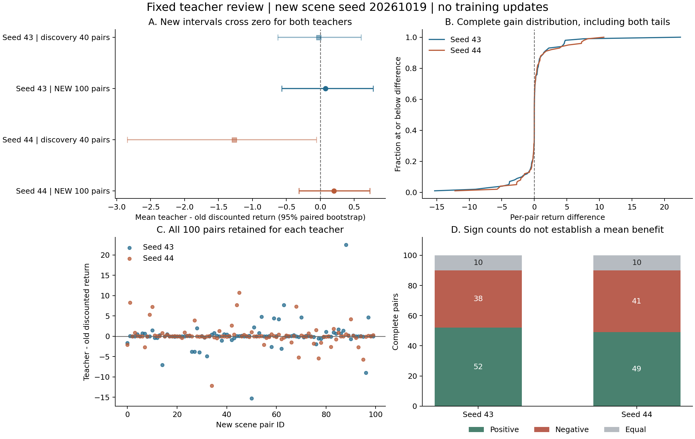

# 固定教师收益复核结果与下一步

2026-10-18，43、44 的两个固定教师各完成 100 对新评价回合。**此前 44 的负收益信号没有在本轮复现，但两个教师的正收益也尚未得到确认。本次封顶复核已结束，其后的四格连续训练也已完成；新的执行安排见本报告末节。**

此次没有更新教师。新旧回报估计从负变正，来自更换评价样本，不能解释为本次措施让策略学得更好了。已有证据支持 Actor 拟合过程改善；整个方法的学习效率或成功率提高仍待验证。

## 1. 新 100 对是本轮主要结果

差值定义为教师实际折扣回报减旧 Actor 回报，正数表示教师更好。主要区间按执行前约定，对完整回合对做 50,000 次 percentile bootstrap，报告双侧 95% 区间。

| 固定教师的数据种子 | 旧 Actor 平均回报 | 教师平均回报 | 平均差 | 95% 配对区间 | 旧 Actor / 教师成功数 |
|---|---:|---:|---:|---|---|
| 43 | -100.05596 | -99.97871 | +0.07726 | [-0.56679, +0.77909] | 0/100 / 0/100 |
| 44 | -101.14523 | -100.94341 | +0.20182 | [-0.31640, +0.72696] | 1/100 / 1/100 |

两个均值都略正，但两个区间均包含零和负值。可以说本轮没有复现明确的平均负收益，不能说已经证明有效、无害或与旧策略等效。

44 的唯一成功发生在 **pair_id=2**：旧 Actor 与教师都在第 **445 步**成功，回报完全相同，差值为 **0**。因此，1% 成功率没有包含教师新增的成功回合。43、44 的旧 Actor 参数相同；两组旧 Actor 回报不相同，是因为动作随机数种子还依赖数据种子，不能把这当作模型被更换。

原始汇总：[43](../s43/summary.json)、[44](../s44/summary.json)。本次从逐回合记录独立复算均值、区间和成本，结果一致，见 [复算指标](metrics.json)。

## 2. 与发现阶段分开对照

| 教师 | 旧 40 对平均差 | 旧 40 对区间 | 新 100 对平均差 | 新 100 对区间 |
|---|---:|---|---:|---|
| 43 | -0.02751 | [-0.62733, +0.59931] | +0.07726 | [-0.56679, +0.77909] |
| 44 | -1.27259 | [-2.84219, -0.05867] | +0.20182 | [-0.31640, +0.72696] |

旧区间使用上一份 [43/44 确认分析](../../actor_fit_e1_confirm_20261018_v1/analysis_20261018/新种子确认分析.md) 的 50,000 次复算口径，分析随机种子为 20261018；新区间使用本轮 manifest 预先固定的 bootstrap 种子。旧 CSV 中较少重采样得到的区间端点略有不同，不影响当时负向信号的描述。

44 的发现结果仍应保留。新结果降低了将“这个教师稳定有害”作为当前首要归因的依据，却不能倒推过去的负收益必然只是噪声。也不能据此宣称方向估计正确、标签无偏或步幅合适；这次只检验两个固定教师在新执行样本上的收益重复性。

新旧数据分开报告，没有合并成 140 对后重新选结论，也没有因结果跨零追加评价。43、44 共享这批新重置场景，分别报告，不能当作 200 个独立重置场景或两个完整训练种子。

## 3. 平均差为什么仍然不稳定

| 教师 | 正 / 负 / 零差回合数 | 中位数 | 最差 / 最好单对差值 | 绝对差不超过 1 的回合数 | 最差 5 对占全部负损失 |
|---|---|---:|---|---:|---:|
| 43 | 52 / 38 / 10 | +0.00047 | -15.32255 / +22.46822 | 75/100 | 62.91% |
| 44 | 49 / 41 / 10 | 0 | -12.19772 / +10.69162 | 76/100 | 61.50% |

多数回合的回报差较小，少数较大正负差会明显影响均值。43 的最佳一对贡献 +22.468，而全部 100 对净和只有 +7.726；不能只看胜出回合更多，就认定期望回报已提高。相同道理，不能删除尾部损失来让结果好看。全部回合保留在主要均值和区间内。

这里的“大差值”是执行结果，不是对根因的定位。没有逐动作完整轨迹，不能仅凭这些表格断言差异究竟来自哪次动作、碰撞或轨迹分叉。

## 4. 实验执行与记账核对

| 验收项 | 本轮结果 |
|---|---|
| 完整数量 | 两组均 completed，各 100 对、200 条策略回合记录 |
| 原固定包 | 文件 SHA-256、冻结目标哈希与此前 E1 manifest 一致 |
| 旧 Actor | 两组参数哈希相同，且与本地原 A0 源 checkpoint 的参数独立核对一致 |
| 模型冻结 | manifest 中运行前后 Actor、方向和教师哈希一致；输入未改动 |
| 方向与步幅 | 两组均继承 U128、η=0.1，没有重新训练或调整 |
| 配对 | 每对 old/teacher 重置种子和动作随机数种子相同，分别按各自策略执行 |
| 新场景 | 20261019 对应 100 个重置种子，与发现阶段 40 个无重叠 |
| 任务设置 | 人数、奖励、折扣、终止和历史规则一致；实际执行 horizon 从训练的 400 切换到原评价规定的 1000 |
| 新增训练成本 | 训练/验证采样步数和方向/Actor/Critic 优化次数全部为零 |
| 执行代码 | manifest 指纹与当前代码一致；原始执行文件为 CRLF，按换行格式核对后匹配 |

| 教师 | 实际联合环境步 | 记录耗时 |
|---|---:|---:|
| 43 | 200,000 | 1,648.53 秒 |
| 44 | 198,890 | 1,635.44 秒 |
| 合计 | **398,890** | **3,283.97 秒，约 54.7 分钟** |

比 400,000 上限少 1,110 步，恰好来自 44 的成功一对：两个策略都在 445 步终止，各少 555 步。不存在少跑回合或把评价成本算成零的情况。

大固定包仍未同步到本地，本次核对的是上传记录、原源 Actor 与执行源码的一致性，未重新执行原教师。12 份原始结果文件内容保持不变，哈希记录在 [metrics.json](metrics.json)。

## 5. 后续短训练状态

本轮按预定规则封顶结束，N64/500k 四格短训练随后完成。固定目标复核不重复执行；下一轮直接开展 N16/N32/N64 与学习率日程的六组连续训练探索。

[当前六组实验方案](../../../../notes/导航采样量与学习率六组实验方案_20261019.md)。旧行动建议已移至[历史执行建议](../../../../archive/notes/历史执行建议_20261019.md)，本节不再作为待执行清单。
